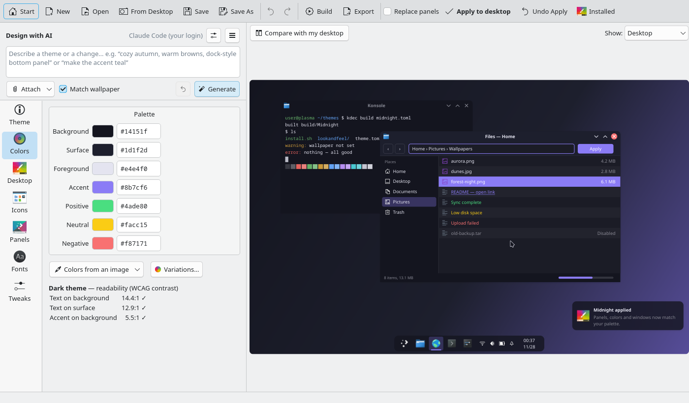
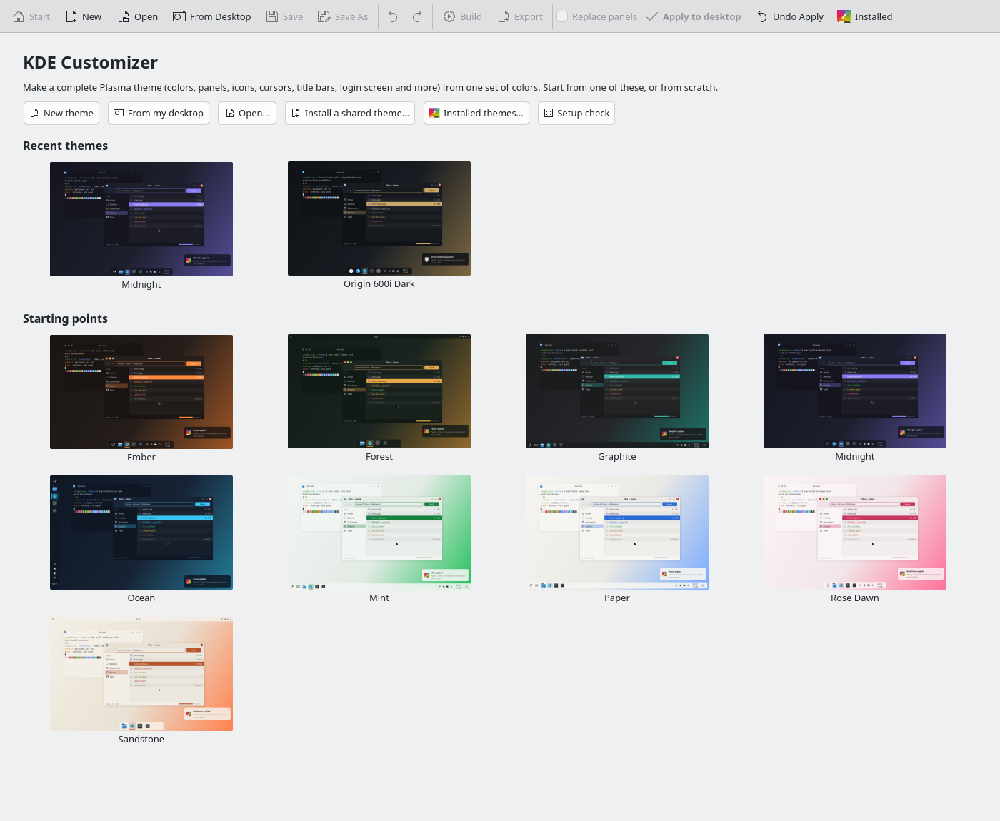

# KDE Customizer

Build complete KDE Plasma 6 themes from one small TOML file, preview them live, and install them with one
click. You can also describe a theme in plain words and let an AI design it.



From about seven palette colors, one theme spec generates:

- a **color scheme** for all apps
- a **Plasma style** (panels, popups, widgets) recolored to match, with your own corner radius, opacity and
  outline, blur and adaptive transparency
- an **app style** (Kvantum: buttons, fields, menus, tabs in your palette, with your corner radius;
  needs the `kvantum` package, otherwise apps keep Breeze)
- a **cursor theme** in your palette (Breeze's cursors recolored: dark, inverted or accent body), for
  Wayland and X11 apps
- the **login screen** (Plasma Login Manager, or SDDM's Breeze theme): your colors, Plasma style, icons, cursors and wallpaper;
  installing asks for the admin password once, and again only when it changes
- a **boot splash** (Plymouth: theme name, progress bar and the disk-unlock prompt in your palette; opt-in,
  installing rebuilds the initramfs)
- a **splash screen** (theme name and a progress bar over a palette gradient or your dimmed wallpaper)
- a **window decoration** (Aurorae title bars in your palette: corner radius, title height, symbol or
  colored-dot buttons)
- a **global theme** package (icons, cursors, app style, window decoration, splash)
- a **panel layout**: position, size, floating or dock-style, and widget order
- a matching **Konsole** color scheme and profile
- matching **kitty, Alacritty, WezTerm, Ghostty and VS Code** themes (where installed; your configs are kept, and
  switched-off apps are restored)
- matching **Firefox** (and LibreWolf) and **Thunderbird**: toolbars, tabs, address bar and menus, through each
  profile's `userChrome.css` (restart the browser to see it)
- **light and dark versions** (opt-in): the opposite version is built from the same hues, and Plasma switches
  between the two at sunrise and sunset; GTK apps, terminals and Konsole switch with it
- a **wallpaper** rendered in your palette by your local image AI (optional)
- matching **GNOME / GTK 4 apps** (libadwaita colors in `~/.config/gtk-4.0`; optionally for Flatpak apps too)
- **fonts**, title-bar buttons and any raw KDE setting (`[tweaks]`)
- a standalone **`install.sh`**, so a built theme can be shared and installed without this tool, which also
  saves a **restore point** first: one command puts your previous desktop back

## Install

Download from the [latest release](https://github.com/RJCogburn/kde-customizer/releases/latest).
It needs KDE Plasma 6 on x86_64.

| Your system | Download | Install |
| --- | --- | --- |
| Arch, CachyOS, Manjaro, EndeavourOS | `kde-customizer-<ver>-1-any.pkg.tar.zst` | `sudo pacman -U ./kde-customizer-*.pkg.tar.zst` (or build it yourself: `makepkg -si` next to [`PKGBUILD`](packaging/aur/PKGBUILD)) |
| Ubuntu, Kubuntu, KDE neon, Debian | `kde-customizer_<ver>_amd64.deb` | `sudo apt install ./kde-customizer_*.deb` |
| Fedora KDE, openSUSE | `kde-customizer-<ver>.x86_64.rpm` | `sudo dnf install ./kde-customizer-*.rpm` / `sudo zypper install ./kde-customizer-*.rpm` |
| Any distribution, no root | `kde-customizer-<ver>-x86_64.tar.gz` | `tar xzf kde-customizer-*.tar.gz && ./kde-customizer-*/install.sh` |
| Any distribution, single file | `KDE_Customizer-<ver>-x86_64.AppImage` | `chmod +x KDE_Customizer-*.AppImage` and run it |

Then start **KDE Customizer** from the application menu. On the command line, `kdec` runs the CLI and
`kdec-gui` the GUI. Check downloads against `SHA256SUMS`.

The .deb, .rpm, .tar.gz and AppImage carry their own Python and Qt in `/opt/kde-customizer`. Many
distributions don't package PySide6, so this works everywhere. The Arch package uses Arch's own Python and
PySide6. In the AppImage the app window uses Qt's own style rather than Breeze. The bundled Qt can't load the
system's KDE style plugin. Themes it builds are not affected.

### From source

```sh
git clone https://github.com/RJCogburn/kde-customizer.git
cd kde-customizer
pip install -e '.[gui,ai]'
```

### Building the packages

```sh
packaging/appimage/build.sh      # AppImage + the bundled runtime in build/appdir
packaging/build-packages.sh      # .tar.gz, and .deb/.rpm when nfpm is installed
```

Pushing a `v*` tag runs `.github/workflows/release.yml`. It builds everything, test-installs each package on
Ubuntu, Debian, Fedora, openSUSE and Arch, and attaches the files to the GitHub release.

## Use

**GUI:** `kdec-gui` (or `kdec-gui mytheme.toml`)

It opens on a start page with your recent themes and nine starting points (five dark, four light), each shown
as a small preview. Pick one, start from scratch, **From my desktop**, or **From a picture…** (a photo or
artwork becomes the wallpaper and the colors). **Install a shared theme…** (or
dropping a `.tar.gz` someone exported on the window) unpacks it into your themes folder and opens it; Apply
then rebuilds it here, so the archive's own script never runs. **Setup check** lists which optional parts
work on your computer (Kvantum, Plymouth, a login manager, the image AI…) with the install command for your
distribution. If the app closed without saving, the start page offers to **Recover** your changes. The
AppImage and the `.tar.gz` tell you there when a new version is out (at most one check a day; **Don't check**
turns it off; distribution packages are updated by your package manager instead).



Edit colors, panels, fonts and the rest in the sections on the left; **Find a setting** (Ctrl+F) above them
jumps to any option by name. The preview on the right redraws as you
type and uses the theme's own icon set; **Compare with my desktop** puts your current desktop next to it,
with a divider to drag. **Ctrl+Z / Ctrl+Shift+Z** undo and redo any change, including AI changes. A yellow
strip above the sections lists anything to fix (hard-to-read colors, an icon or cursor theme that isn't
installed…), with a link to where it's fixed. On the Colors page, **Colors from an image** makes a readable
palette from the wallpaper or any picture, and **Variations…** shows nearby palettes (accent turned, warmer,
cooler, more contrast, more or less color) as previews to pick from. The menu above the preview shows it as
people with red-, green- or blue-blindness (or no color vision) see it, to check that the accent, warnings and
errors still look different.

**Apply to desktop** first lists what will change, with a checkbox for each part you can leave as it is this
time (wallpaper, panels, GTK apps, terminals, Firefox/Thunderbird, VS Code, tweaks, login screen, boot
splash); it remembers your choice per theme, and says whether you'll be asked for the admin password (only when
the login screen or boot splash changed). Then it installs the theme and switches to it, showing each step. If
something fails, it says in plain words what probably went wrong (a missing tool, a full disk, a cancelled
password prompt…) and what to do.
Afterwards you have 20 seconds to click **Keep changes**; with no answer (or **Undo**) the desktop goes back
to how it was, like the display settings do. **Installed…** lists the themes kde-customizer has installed and
removes the ones you don't use; a theme whose file you changed since installing it is marked, with **Update…**
to apply it again.
**From Desktop** starts a theme from what you're running now. **Show:** above the preview opens the app
launcher, calendar, system tray or an app dialog in your theme (or click the launcher, clock or tray in the
preview's panel). The **Tweaks** tab edits any KDE setting,
with ready-made rows for popular ones (wobbly windows, magic lamp, glide, centered windows, no title bars on
maximized windows, thumbnail Alt+Tab, warmer Night Light…). **Undo Apply** puts the desktop back the way it
was before the last Apply; its arrow lists earlier versions to go back to. **Make…** next to the wallpaper renders
one in your palette with your local image AI. **Export**'s arrow has **For the KDE Store…**: one file per part
(global theme, Plasma style, colors, icons, cursors, title bars…) plus an `UPLOAD.md` saying which store category
each one goes in.

**Command line:**

```sh
kdec new mytheme.toml                  # starter spec
kdec snapshot mydesktop.toml           # spec from your current desktop: colors, styles, fonts, panels, wallpaper
kdec build mytheme.toml                # -> build/<Name>/
kdec apply mytheme.toml --dry-run      # show what would change
kdec apply mytheme.toml [--layout]     # install + apply (--layout also replaces your panels)
kdec apply mytheme.toml --skip gtk --skip boot   # leave parts as they are this time (see kdec apply -h)
kdec export mytheme.toml               # shareable <Name>.tar.gz including the wallpaper
kdec export mytheme.toml --store       # files for store.kde.org, one per part, + UPLOAD.md
kdec check mytheme.toml                # readability (contrast) and missing-theme warnings
kdec revert                            # undo the last apply (kdec revert --list, kdec revert 2, …)
kdec wallpaper mytheme.toml "misty mountains at dusk"   # render a wallpaper in the palette (local image AI)
kdec palette mytheme.toml [image]      # colors from an image (default: the theme's wallpaper); --dark/--light
kdec installed                         # themes kde-customizer installed; --remove NAME deletes one
kdec doctor                            # which optional parts work here, with install commands for your distro
kdec icon-names [word]                 # icon names and what each one is for (--apps, --all --base Papirus)
```

**Undo:** every install first records your current desktop (colors, styles, icons, cursors, fonts, wallpaper,
window settings, tweaks, terminal/GTK/Firefox configs, and your panels with `--layout`) in
`~/.local/state/kde-customizer/restore/`. `kdec revert` (or **Undo Apply**) restores the latest one; run it
again to step further back. The newest 10 are kept. Each one is also a plain `restore.sh`, so people you share
a theme with can undo it without this tool. The login screen, boot splash and VS Code extension are not reverted.

**Light and dark:** with `[light_dark] auto = true` (GUI: *Light and dark versions, switched by time of day*),
the build also makes "<Name> Light" (or "<Name> Dark") from the same hues, and Plasma switches between the two
on Night Light's sunrise/sunset schedule. A small user service (`kdec-follow.path`) switches GTK 4 apps, kitty,
Ghostty, Alacritty, Konsole and Firefox (on its next start) along with it. Apps use the fallback app style
instead of Kvantum, because a Kvantum style can't switch with the colors.

**Wallpaper and System Settings:** the wallpaper is installed as a Plasma wallpaper package and named in the global
theme, so it stays when Plasma rebuilds the desktop (System Settings › Global Themes with *Desktop and window layout*,
or **Replace panels**). Each global theme also carries pictures of its own desktop, so System Settings shows your theme
rather than Breeze. Apply a theme again to update ones installed with older versions.

Someone you share an export with only needs `tar xzf Name.tar.gz && ./Name/install.sh`.
Themes with `[login_screen]` or `[boot_splash]` ask for the admin password once (only when those parts changed).
`./install.sh` leaves a part exactly as it is with `--no-login`, `--no-boot`, `--no-wallpaper`, `--no-gtk`,
`--no-terminals`, `--no-browsers`, `--no-vscode` or `--no-tweaks` (the header of install.sh lists them).

## Tests

```sh
pip install -e '.[gui,test]'
QT_QPA_PLATFORM=offscreen pytest -q
```

The suite never touches your desktop: every test gets its own temporary `HOME` and XDG folders, and
stand-ins for the tools that would reach the running session or root (`pkexec`, `plasma-apply-*`, `qdbus6`,
`systemctl`…).
GUI tests need PySide6 and the login-screen tests need `kwriteconfig6`; each group is skipped without them.

## Design with AI

Type a request such as *“cozy autumn, warm browns, dock-style bottom panel”* or *“make the accent teal”*
into **Design with AI** (GUI) or run:

```sh
kdec ai "cozy autumn, dock-style panel" --from mytheme.toml
```

**Design from something:** attach images, PDFs (a product brochure, brand guide or mood board), Word or
text files, or a link to any of them, and the AI builds the theme from them: exact hex codes, key colors,
light or dark mood, and style cues like a dock or flat panels. In the GUI use **Attach → Files… / Link…**
or drag files and links onto the AI panel. On the command line use `--ref` (repeatable):

```sh
kdec ai "luxury explorer feel" --ref https://example.com/brochure.pdf --ref moodboard.png
```

Claude providers see PDFs page by page, visuals included. Other providers get images plus the PDF's text.

With **Match wallpaper** on, the AI looks at your wallpaper and builds the palette from it. Every result is
checked for readable contrast and for icon, cursor and Plasma themes that aren't installed. If a check
fails, the AI is asked to fix it once.

| Provider | What you need |
| --- | --- |
| **Claude Code** (default) | The `claude` CLI, signed in. Uses your Claude plan, no API key. |
| Claude API | `ANTHROPIC_API_KEY` and `pip install -e '.[ai]'` |
| OpenAI / Gemini / OpenRouter | API key env var and a model name |
| Ollama / LM Studio | A local server and a model name |

Choose the provider with the gear button in the GUI, or with `--provider` / `--model` on the command line.

**Any chat AI, no setup:** in the GUI menu use *Copy prompt for any chat AI*, paste it into the AI, then
*Paste AI reply…*. On the command line, `kdec ai "..." --prompt-only` prints the same prompt.

**Coding agents:** `kdec ai-guide` prints the full spec reference, including the themes installed on this
machine, so an agent can write theme files directly.

## Icons

**Matching icon set:** on the **Icons** tab tick *Generate a matching icon set* and pick a base theme you
have installed (Papirus, Breeze, McMojave, Gruvbox…). Its folders and places are recolored to your accent,
and everything else is inherited from it. This takes about 0.2 seconds and runs on every build.
Tick *Restyle every app's icon* to give every installed app (Flatpaks too) the theme's look: each keeps its
own logo in its own colors, on a graphite plate with an accent rim.

**Your own icons:** made them yourself, in any app? Point *Your own icons* at a folder of SVG or PNG files
named after the icon they replace — `folder-music.svg`, `user-trash.png`, `firefox.svg` — and they win over
everything else (the rest still comes from the generated set). **Icon names…** shows every name with what it's
for (folders and places, apps, launcher categories, devices, file types, actions, status, emblems, every app
on this computer, and every name in your base theme), what your theme shows for it now, and yours. Pick a name
and **Use my image…** to add one file at a time. File names nothing asks for are flagged, since they're usually
typos. SVG stays sharp at every size; PNGs should be square, 256 px or more.

```sh
kdec icon-names trash                                  # names and what they're for
kdec icons mytheme.toml --custom ~/Pictures/my-icons   # use your folder (--custom '' stops)
```

**Signature icons:** custom versions of the 14 icons you see most (folders, home, trash, app launcher,
file manager, terminal, browser, settings), made in a style you describe:

| Made by | How |
| --- | --- |
| AI-drawn vectors | Your AI provider (default Claude Code) draws them as SVG. Crisp at every size. |
| Local image AI | Your own **Fooocus**, **ComfyUI** or **A1111/Forge** renders them; the background is cut away. |
| Any image app | *Copy prompts…*, make them in ArtCraft, Krita AI or similar, then *Import images…* |

```sh
kdec icons mytheme.toml --style "brushed gold metal, dark glass"            # AI-drawn vectors
kdec icons mytheme.toml --mode image --image-url http://127.0.0.1:7865       # local image AI (Fooocus port)
kdec icons mytheme.toml --mode image --only user-trash,utilities-terminal    # remake a few
kdec icons mytheme.toml --mode image --list-models                           # your image AI's checkpoints
kdec icons mytheme.toml --mode image --image-model auto                      # or a checkpoint name
kdec icons mytheme.toml --prompts > prompts.txt                              # for any image app…
kdec icons mytheme.toml --import ~/Pictures/my-icons                         # …then import (folder.png, …)
```

Signature icons are kept in a folder next to the theme file and bundled into exports. Rendered icons get their
background cut out by a segmentation model (rembg) when one is reachable — installed for kde-customizer, or the
one your image AI already ships (Fooocus, ComfyUI and A1111 have it; it's found automatically while the AI runs)
— and by a built-in cutter otherwise. **Model** picks the checkpoint they're rendered with: your image AI's
default, **Auto** (the best fit for clean object renders among your checkpoints) or any one it lists. The raw renders are kept, so **Re-cut backgrounds** (or
`kdec icons mytheme.toml --recut`) redoes the cut-outs later without rendering again.

## Wallpaper

`kdec wallpaper mytheme.toml "armored hangar bay at night"` (or **Make…** on the Desktop tab) renders a
wallpaper with the same local image AI and checkpoint as the icons. The prompt carries your palette (background
tones, accent glow), it's rendered at the SDXL size closest to your screen's shape and scaled up to your screen
(`--size 3840x2160` to choose), then saved next to the theme and set as its wallpaper. `--prompt-only` prints the
prompt for any other image app.

## Theme spec

```toml
name = "Midnight"
id = "org.kdecustomizer.midnight"
icons = "breeze-dark"
wallpaper = "wallpapers/night.jpg"

[palette]
background = "#14151f"
surface = "#1d1f2d"
foreground = "#e4e4f0"
accent = "#8b7cf6"

[plasma]
generate = true        # palette-matched Plasma style
radius = 12            # rounder floating panels and popups (Breeze: 6)

[[panels]]
location = "bottom"
floating = true
length_mode = "fit"    # dock-style
widgets = ["org.kde.plasma.kickoff", "org.kde.plasma.icontasks", "org.kde.plasma.systemtray", "org.kde.plasma.digitalclock"]
```

See [`examples/midnight.toml`](examples/midnight.toml) for a complete spec, or run `kdec ai-guide` for
every key.

## License

GPL-3.0-or-later. See [LICENSE](LICENSE).
